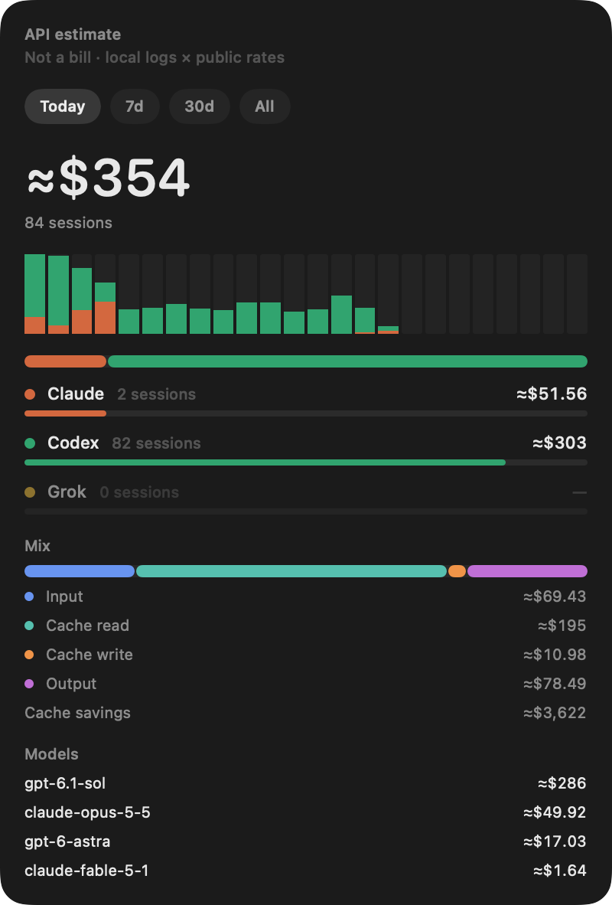

<p align="center">
  
</p>

# Gaisan

Menu bar app for macOS. It shows an API-price estimate of local Claude, Codex, Grok, and Pi logs. This is not a bill. The ticker is **today** plus the amount, and it updates when the local usage cache changes. Click it for Today / 7d / 30d / All, source mix, cache savings, and top models.

<p align="center">
  
</p>

Requires macOS 14 or later, on Apple silicon or Intel.

Gaisan is a separate app from [Uso](https://github.com/bujosa/uso), which shows remaining plan quota.

## Install

Paste this in Terminal:

```sh
curl -fsSL https://raw.githubusercontent.com/bujosa/gaisan/main/scripts/get.sh | bash
```

It downloads the latest release for your chip (Apple silicon or Intel), checks it against its SHA-256 checksum and code signature, installs `Gaisan.app` in `~/Applications` (or replaces the copy already in `/Applications`), and opens it. Run it again to update. You can [read the script](scripts/get.sh) first.

Gaisan is locally signed, not Apple-notarized. macOS asks for approval when a browser downloads an app like this, but not when `curl` downloads it, so the app opens right away.

Look in the menu bar for `today` and a dollar amount. The app does not show a Dock icon.

### Manual download

Download the zip for your Mac from the [releases page](https://github.com/bujosa/gaisan/releases/latest): `apple-silicon` for M-series chips, `intel` for Intel processors. Apple menu > About This Mac shows which one you have.

1. Unzip the file. You get `Gaisan.app`.
2. Move `Gaisan.app` into Applications.
3. Open it. macOS says it can't check the app. Open System Settings > Privacy & Security, click Open Anyway, and confirm. On macOS 14 you can instead right-click `Gaisan.app`, choose Open, then Open again.

## From source

```sh
./scripts/install.sh
```

That builds a universal release binary (arm64 and x86_64), installs `~/Applications/Gaisan.app`, and opens it. `./scripts/package.sh` writes the signed universal app plus one signed zip and SHA-256 checksum per chip, `dist/Gaisan-0.1.0-macOS-apple-silicon.zip` and `dist/Gaisan-0.1.0-macOS-intel.zip`, without installing anything. It stops if either architecture is missing.

Run `swift test` for estimate folding, cache-aware prices, snapshot reuse, and idle Grok rows. Run `swift build -c release --arch arm64 --arch x86_64` to check the release build. CI runs both, plus `swift format lint --strict` and a script check, on every pull request.

`swift run Gaisan --print` prints today's / 7-day / 30-day / all-time totals without opening the menu bar.

## What the panel shows

- **Today / 7d / 30d / All.** The same local logs, cut to that window. The menu bar always shows today.
- **Sources.** Claude, Codex, Grok, and Pi when those logs exist on this Mac. A quiet source still appears as a dash so the mix does not jump around.
- **Mix.** Uncached input, cache reads, cache writes, and output, priced separately. Cache savings is what those reads would have cost at the uncached input rate.
- **Models.** Highest spend first in the selected window.

Bars fill against the window total. The number is an estimate at public API list prices, or a provider-reported cost when the row already has one. Gemini and OpenCode are not in this cache yet. Remaining plan quota stays in Uso.

If the local logs are missing, the status item stays hidden.

## Where the numbers come from

Gaisan reads files already on this Mac. It does not ask for an API key and it does not talk to a billing API.

| Source | Local logs |
| --- | --- |
| Claude | `~/.claude/projects` |
| Codex | `~/.codex/sessions` |
| Grok | `~/.grok/sessions` |
| Pi | `~/.pi/agent/sessions` |

Rows are folded from the usage scan cache at `~/.t3/userdata/usage-scan-cache-v5.json`, with rates from `~/.t3/userdata/usage-model-rates.json` when that file is present. Pricing uses uncached input, cache reads, cache writes, and output. Reasoning tokens are already inside output. A snapshot at `~/Library/Caches/Gaisan/snapshot.json` keeps the panel instant on the next open.

This is an estimate, not a statement from Anthropic, OpenAI, xAI, or anyone else.

## License

MIT. See [LICENSE](LICENSE).
